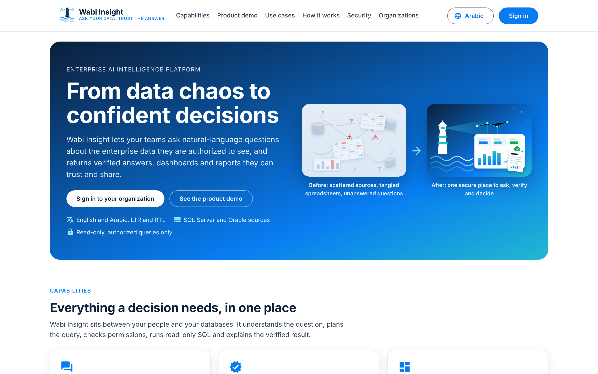
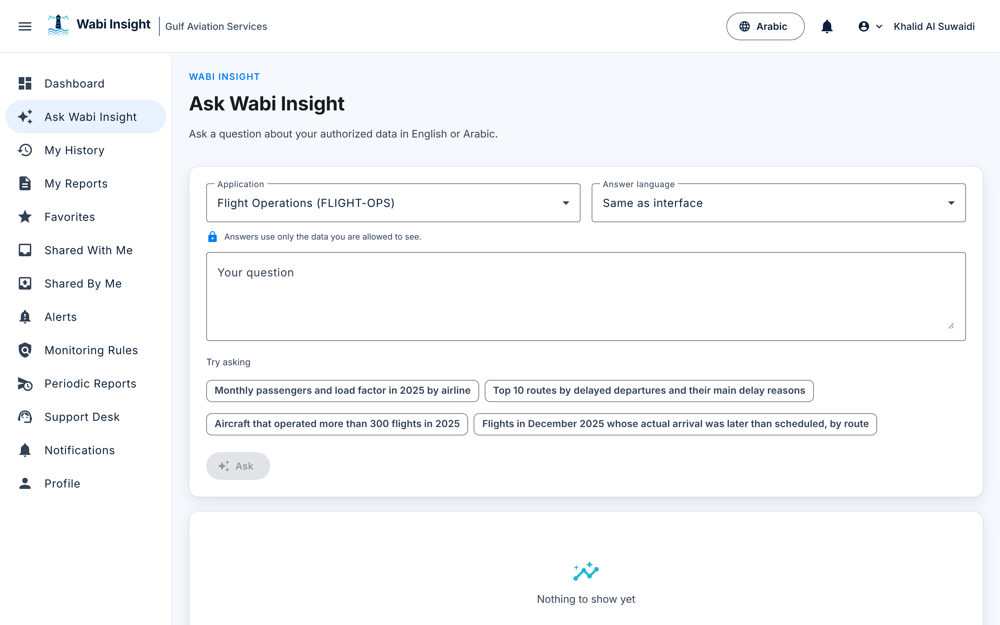
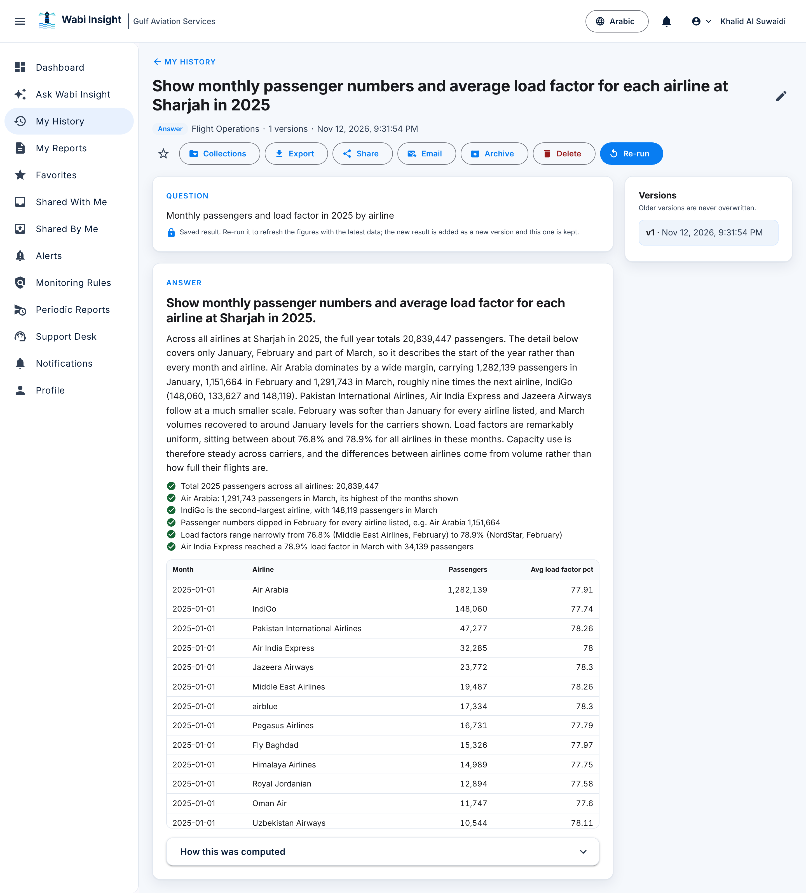
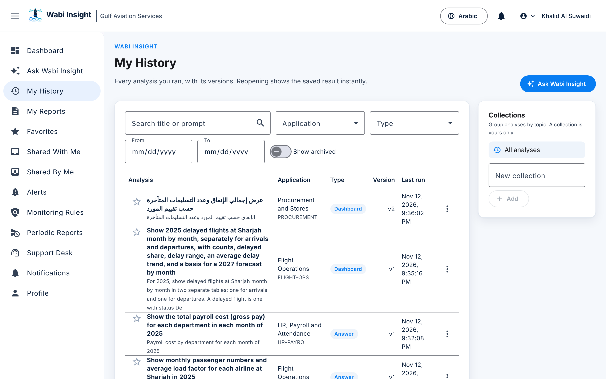
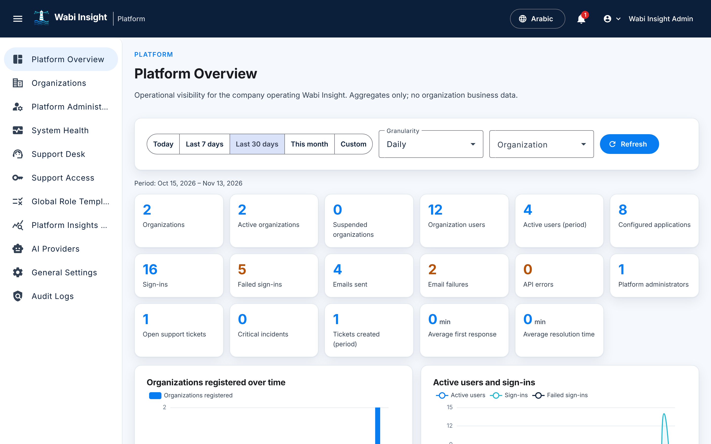
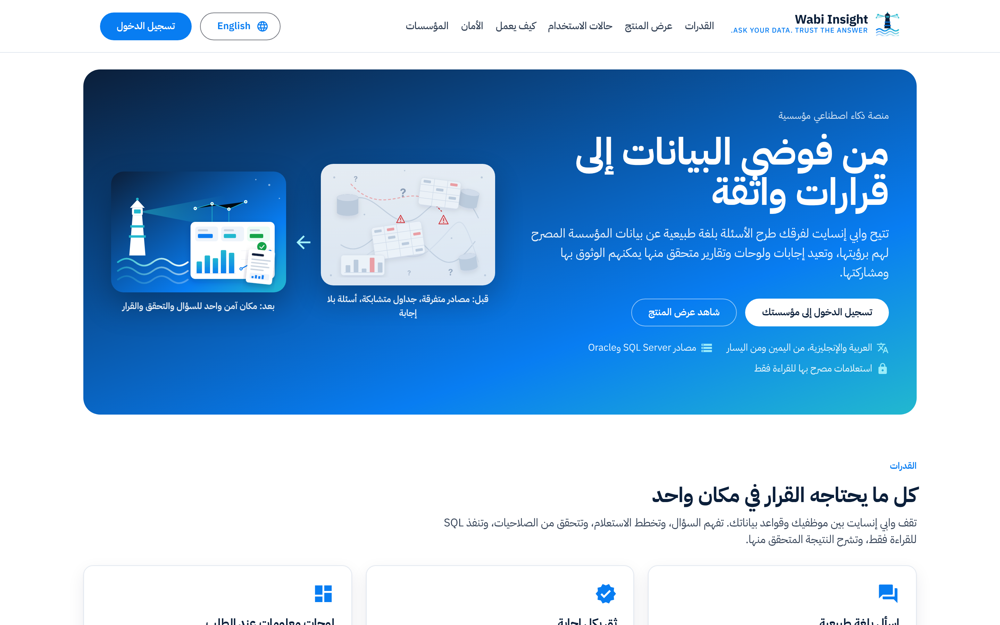
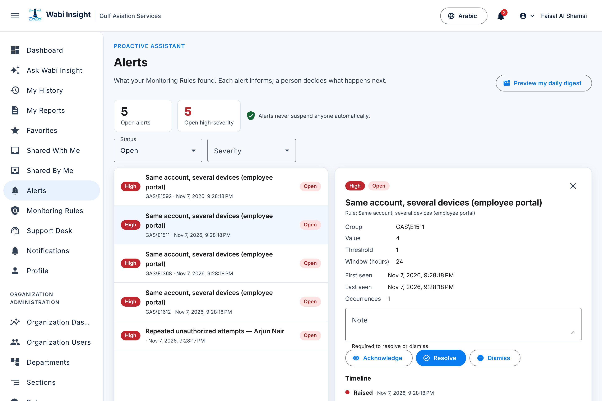
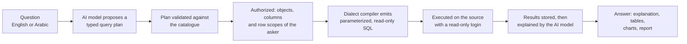
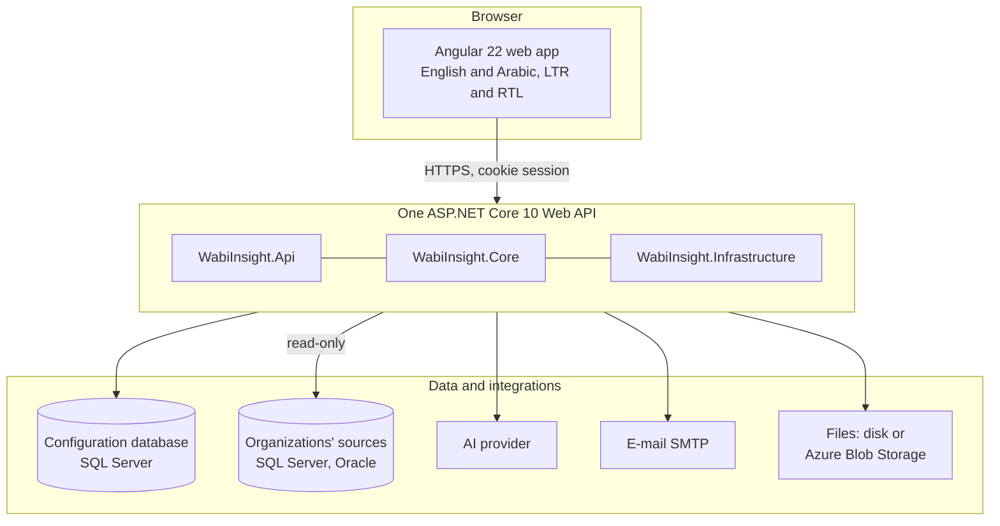

<p align="center">
  <picture>
    <source media="(prefers-color-scheme: dark)" srcset="src/web/public/brand/wabi-insight-wordmark-dark.svg">
    
  </picture>
</p>

<p align="center">
  <strong>Ask Your Data. Trust the Answer.</strong> · اسأل بياناتك. وثق بالإجابة.
</p>

<p align="center">
  <a href="https://github.com/mtawfig/wabi-data-harbor/actions/workflows/ci.yml"></a>
  
  
  
  
  
</p>

**Wabi Insight** (platform code AP-AIR) is a secure, bilingual, multi-organization enterprise AI intelligence platform.
Employees ask questions in English or Arabic about the business data they are allowed to see, and get verified
answers, charts and reports they can save, export and share. The company that operates the platform has its own
administration and support area and never sees an organization's business data.

<p align="center">
  
</p>

## Contents

- [What it does](#what-it-does)
- [Screenshots](#screenshots)
- [How an answer is produced](#how-an-answer-is-produced)
- [Architecture](#architecture)
- [Technology](#technology)
- [The deployed version](#the-deployed-version)
- [Getting started (development)](#getting-started-development)
- [Tests and quality checks](#tests-and-quality-checks)
- [Sample organizations](#sample-organizations)
- [Deployment](#deployment)
- [CI/CD](#cicd)
- [Repository layout](#repository-layout)
- [Documentation](#documentation)
- [Security](#security)
- [Status and roadmap](#status-and-roadmap)
- [Working on this repository](#working-on-this-repository)
- [License](#license)

## What it does

| Area | What users get |
|---|---|
| **Ask** | Natural-language questions over the organization's SQL Server and Oracle databases, in English or Arabic. Answers come as a written explanation, tables, charts and KPIs, with a plain-language *How this was computed*. |
| **Studies and reports** | Multi-panel studies with a PDF report; exports to PDF, Word and Excel; Arabic and right-to-left throughout. |
| **History and sharing** | Every answer is saved with versions; favorites and collections; sharing with colleagues and by e-mail, always limited to what the recipient may see. |
| **Permissions** | Roles per organization, object and column permissions, and row scopes (`ALL`, `DEPARTMENT`, `SECTION`, `SELF`), so two people asking the same question see only their own rows. |
| **Proactive agent** | Monitoring Rules that watch the data and raise Alerts, daily digests, and Periodic Reports rendered for each recipient under that recipient's permissions. |
| **Organization administration** | Users, structure, roles, applications (data sources) with read-only connection checks, the data catalogue, example questions, settings and logo. |
| **Platform administration** | Organizations, administrators, AI providers, system health, audit log, support desk, and scoped, time-limited support access; never business data. |
| **Operations** | Self-service password reset by e-mail, health checks, an application log file, encrypted secrets, nightly backups, one-click deployments. |

## Screenshots

Taken from the deployed site (see [The deployed version](#the-deployed-version)). The full set of 42 screens in English
and Arabic, desktop and mobile, is in [docs/SCREENSHOTS.md](docs/SCREENSHOTS.md).

| Ask Wabi Insight | An answer, saved in My History |
|---|---|
|  |  |

| My History | Platform overview (operator's view: counts only) |
|---|---|
|  |  |

| Arabic, right to left | Alerts from Monitoring Rules |
|---|---|
|  |  |

**Videos and recordings**

- Narrated product walkthrough on the Wabi Bank sample, with subtitles and chapters:
  [English](docs/demo/wabi-insight-walkthrough-en.mp4) ([script](docs/demo/wabi-insight-walkthrough-en.md)) ·
  [Arabic](docs/demo/wabi-insight-walkthrough-ar.mp4) ([script](docs/demo/wabi-insight-walkthrough-ar.md))
- [Proactive agent raising an alert](docs/demo/p14-5-proactive-agent-alert.gif) ·
  [Row scopes and an AML alert at Wabi Bank](docs/demo/p13-6-wabi-bank.gif) ·
  [Ask, study, report, e-mail](docs/demo/p8-4-ask-study-report-email.gif)
- [A generated study report (PDF)](docs/demo/p8-4-sharjah-airport-traffic-and-punctuality-study-2025-20261106.pdf)

## How an answer is produced

The AI model never writes SQL and never touches the data directly.



- The model only proposes a **plan** (which objects, columns, filters and aggregates). The API validates it, checks it
  against the asker's permissions, and compiles the SQL itself for SQL Server or Oracle.
- Row scopes are added by the API after organization and application ownership; `ALL` never crosses organizations.
- The explanation is written from the query results only: the model is told never to invent or extrapolate numbers.
- Every query, its plan and its outcome are recorded in append-only logs.

## Architecture

Exactly three logical layers. No microservices, message brokers or separate Python services.



- **Two kinds of account.** Platform Administrators have no organization; organization users always have one. The
  organization of a request always comes from the signed-in session, never from the request or from AI output.
- **Tenant isolation twice over:** database query filters and explicit ownership checks in every service.
- **Secrets** (connection strings, provider keys) are encrypted with ASP.NET Core Data Protection and never sent to the
  browser.

More: [docs/ARCHITECTURE.md](docs/ARCHITECTURE.md).

## Technology

| Layer | Stack |
|---|---|
| Web app | Angular 22 (standalone components, signals), Angular Material (M3 brand theme), Transloco (English and Arabic), ECharts |
| API | .NET 10 LTS, ASP.NET Core, Entity Framework Core, C# with nullable reference types |
| Databases | SQL Server 2019–2025 including Express (configuration database); SQL Server and Oracle as organizations' sources |
| AI | Anthropic Claude by default; OpenAI-compatible and Gemini adapters; an organization may use its own provider |
| Files | Server disk or a private Azure Blob Storage container |
| Reports | PDF (QuestPDF), Word, Excel, server-drawn charts with Arabic text |
| Tests | xUnit (unit and SQL Server integration), Vitest, Playwright |
| Delivery | GitHub Actions; IIS, nginx + systemd, Docker Compose (Caddy), Azure App Service |

## The deployed version

Version 1 is live as the first test deployment.

| | |
|---|---|
| **Address** | <https://insight.wabitex.com> |
| **Deployed** | 2026-11-12, commit [`6ce3331`](https://github.com/mtawfig/wabi-data-harbor/commit/6ce3331fb3ef2b06fe41989a9832585f59062262), with *Actions → Deploy (Windows)* |
| **Server** | A Windows Server VPS: the web app and the API in IIS (URL Rewrite + ARR), HTTPS from Let's Encrypt (win-acme) |
| **Databases** | SQL Server 2022 Express on the same server: the platform database `WabiInsightDB` and the eight sample databases |
| **Files** | Azure Blob Storage, UAE North (private container, firewall limited to the server) |
| **Backups** | Nightly at 02:30: Wabi Insight's databases, their logins and the key ring; 7 nights on the server, copies in Azure for 30 days |
| **AI provider** | Anthropic (platform default) |
| **Health** | <https://insight.wabitex.com/health/ready> reports the API, database, schema, file storage and key ring |
| **Guide followed** | [docs/DEPLOYMENT_WINDOWS_AZURE.md](docs/DEPLOYMENT_WINDOWS_AZURE.md) |

**What is on it.** Two sample organizations with fictional data, used for testing:

| Organization | Applications | Users |
|---|---|---|
| Gulf Aviation Services (GAS) | Flight Operations · HR, Payroll and Attendance · Procurement and Stores | 4 |
| Wabi Bank (WBK) | Personnel and Attendance · Core Banking · Finance · Digital Banking · IT Help Desk | 8 |

All eight applications are connected with read-only logins and approved; questions in English and Arabic return
answers. Sample users and what each may see: [GAS](scripts/sql/samples/README.md#sample-users) ·
[Wabi Bank](scripts/sql/samples/wabi-bank/README.md#users). Passwords are not kept in this repository.

**Updating it.** *Actions → Deploy (Windows) → Run workflow* on `main`. Deployments never start by themselves. The
workflow builds and tests on GitHub, then the runner on the server backs up, migrates the database when asked, installs
the release, waits for the health check and puts the previous release back if it fails.

**Not yet on it.** Real organizations' data: the server is outside the UAE and is for testing only. The production
target is a server in the UAE with the same setup; the guide's step *A new VPS from the Azure backups* moves it.

## Getting started (development)

**Prerequisites:** .NET 10 SDK (pinned by [`global.json`](global.json)), Node.js 22, Docker (for the local SQL Server
and the integration tests).

```bash
# 1. Local SQL Server 2022
docker compose -f docker-compose.dev.yml up -d

# 2. This machine's settings (git-ignored): local database, file e-mail sink, bootstrap values
cp src/WabiInsight.Api/appsettings.Local.example.json src/WabiInsight.Api/appsettings.Local.json

# 3. API: create the tables, the first Platform Administrator, then run on http://localhost:5080
dotnet run --project src/WabiInsight.Api -- migrate
dotnet run --project src/WabiInsight.Api -- bootstrap
dotnet run --project src/WabiInsight.Api

# 4. Web app on http://localhost:4200 (proxies /api to the API)
cd src/web && npm ci && npm start
```

On a machine without a system .NET install: `./scripts/install-dotnet.sh && export PATH=$HOME/.dotnet:$PATH`.

`appsettings.json` carries the shared settings of this private repository (owner decision G). Everything specific to
a machine or a server goes into the git-ignored `appsettings.Local.json`, user secrets or environment variables.
All commands: [CLAUDE.md, *Essential commands*](CLAUDE.md#essential-commands).

## Tests and quality checks

```bash
dotnet build WabiInsight.slnx -c Release          # warnings are errors
dotnet test  WabiInsight.slnx -c Release          # unit + SQL Server integration (Docker or WI_TEST_SQLSERVER_CONNECTION)
cd src/web && npm run lint && npm test && npm run build -- --configuration production
```

- **Unit tests:** 427, run on Linux and on Windows in CI.
- **Integration tests:** against a real SQL Server (migrations, tenant isolation with at least two organizations, row
  scopes, support desk, sample scripts), Azurite for Blob Storage, and Oracle Free end to end.
- **Web:** lint, Vitest unit tests and a production build.
- **Containers:** both images are built and the whole Docker server stack is started, backed up and restored in CI.

## Sample organizations

Two complete, fictional organizations with realistic 2025 data, permissions, example questions and planted findings
for the monitoring rules:

| Organization | Scripts | Contents |
|---|---|---|
| Gulf Aviation Services | [`scripts/sql/samples`](scripts/sql/samples/README.md) (01–04) | 3 databases: 132,096 flights, 599 employees with payroll and attendance, procurement and stores |
| Wabi Bank | [`scripts/sql/samples/wabi-bank`](scripts/sql/samples/wabi-bank/README.md) (01–07) | 5 databases: personnel, core banking (5,978 customers, 569,547 postings), finance, digital banking, IT help desk |

Run them in order after `migrate`; the deployment guides show how on each kind of server.

## Deployment

Step-by-step guides written for beginners: every step says where, why, how to check, what to do, what you should see,
what to do if not, and how to verify.

| Target | Guide |
|---|---|
| Windows Server VPS, files and backup copies in Azure Blob Storage (the deployed setup) | [DEPLOYMENT_WINDOWS_AZURE.md](docs/DEPLOYMENT_WINDOWS_AZURE.md) |
| Windows Server VPS, everything on the server | [DEPLOYMENT_WINDOWS_SERVER_2019.md](docs/DEPLOYMENT_WINDOWS_SERVER_2019.md) |
| Ubuntu with Docker (containers, `wabi-docker`, move to another server or an Azure VM) | [DEPLOYMENT_LINUX_DOCKER.md](docs/DEPLOYMENT_LINUX_DOCKER.md) |
| Ubuntu with nginx and systemd | [DEPLOYMENT_LINUX.md](docs/DEPLOYMENT_LINUX.md) |
| Azure App Service, Azure SQL and Blob Storage | [DEPLOYMENT_AZURE.md](docs/DEPLOYMENT_AZURE.md) |
| Overview and every configuration key | [DEPLOYMENT.md](docs/DEPLOYMENT.md) |

## CI/CD

| Workflow | Starts | Does |
|---|---|---|
| **CI** | On every pull request and every merge to `main` | Builds and tests the API (Linux and Windows) and the web app, audits dependencies, runs the Oracle end-to-end tests, builds the container images and exercises the Docker server stack |
| **Deploy (Windows)** | By hand | Builds a release and installs it on a Windows server through its self-hosted runner |
| **Deploy (Linux)** | By hand | The same for an Ubuntu server with nginx and systemd |
| **Deploy (Docker)** | By hand | Builds and publishes private images, then `wabi-docker deploy` on the Docker server |
| **Deploy (Azure)** | By hand | Creates the Azure resources and deploys the database, API and web app |

No server secret is stored in GitHub: each server keeps its own settings. Details:
[DEVOPS_WINDOWS.md](docs/DEVOPS_WINDOWS.md) · [DEVOPS_LINUX.md](docs/DEVOPS_LINUX.md).

## Repository layout

```
src/
  WabiInsight.Api/             ASP.NET Core Web API: controllers, contracts, security, commands (migrate, bootstrap, …)
  WabiInsight.Core/            Entities, rules and interfaces
  WabiInsight.Infrastructure/  Persistence (EF Core, migrations), AI, query compilers, reports, e-mail, storage, jobs
  web/                         Angular web app (English and Arabic)
tests/
  WabiInsight.UnitTests/       Unit tests
  WabiInsight.IntegrationTests/ SQL Server, Azurite and Oracle integration tests
deploy/                        IIS, nginx, systemd, Docker (server stack and wabi-docker), Azure (Bicep), CI/CD scripts
scripts/                       Sample databases, screenshots, demos, load check, .NET install
docs/                          Specification, plan, progress, guides, screenshots, demos
.github/workflows/             CI and the deployment workflows
```

## Documentation

| Topic | Document |
|---|---|
| Requirements | [Product specification](docs/WABI_INSIGHT_SPECIFICATION.md) · [Specification review and owner decisions](docs/SPEC_REVIEW.md) |
| Plan and history | [Implementation plan](docs/IMPLEMENTATION_PLAN.md) · [Progress log](docs/PROGRESS.md) |
| Design | [Architecture](docs/ARCHITECTURE.md) · [Design system](docs/DESIGN_SYSTEM.md) · [Proactive agent](docs/PROACTIVE_AGENT.md) |
| Quality | [Security](docs/SECURITY.md) · [Performance](docs/PERFORMANCE.md) · [Screens](docs/SCREENSHOTS.md) |
| Operations | [Deployment](#deployment) · [CI/CD](#cicd) |
| Next version | [Version 2: scope, business model and proposals](docs/VERSION_2.md) |
| For Claude Code sessions | [CLAUDE.md](CLAUDE.md) |

## Security

- Sign-in with a secure, HTTPS-only session cookie, CSRF protection, rate limits, lockout, and reset links by e-mail
  (30 minutes).
- Strict security headers (HSTS, Content Security Policy, frame blocking), request size limits, optional attachment
  scanning.
- Source databases are reached with read-only logins, and a connection is approved only after the API has verified it
  cannot write.
- Audit logs, usage events and alert records are append-only.
- Platform Administrators reach an organization's configuration only through an approved, unexpired, scoped support
  grant, and never its business data.

Controls, the cross-tenant sweep and how to report an issue: [docs/SECURITY.md](docs/SECURITY.md).

## Status and roadmap

- **Version 1:** feature-complete (phases 1–14 of the plan) and deployed for testing. Current work is deployment
  readiness: guides and fixes from the first deployment ([progress log](docs/PROGRESS.md)).
- **Version 2 (planned, not built):** [docs/VERSION_2.md](docs/VERSION_2.md): API data sources, drill-down in charts,
  Sign in with Microsoft and Active Directory, Google Drive and OneDrive publishing, WhatsApp, the Wabi Data Gateway,
  service plans, and proposals still to decide (a database per organization, forecasts in answers).

## Working on this repository

- One pull request per branch, titled `P<phase>.<n> — <description>`; `main` is merged by the owner only.
- Every pull request keeps [docs/PROGRESS.md](docs/PROGRESS.md) current and passes CI.
- Before pushing: `dotnet build` and `dotnet test` green; web lint, tests and build green; UI changes checked in the
  browser with real screenshots.
- The architectural rules that are never weakened are listed in [CLAUDE.md](CLAUDE.md#architectural-invariants-never-weaken).

## License

Proprietary. © WabiTex Solutions FZE. All rights reserved. This is a private repository; no licence is granted to use,
copy or distribute the software or its documentation without written permission.
